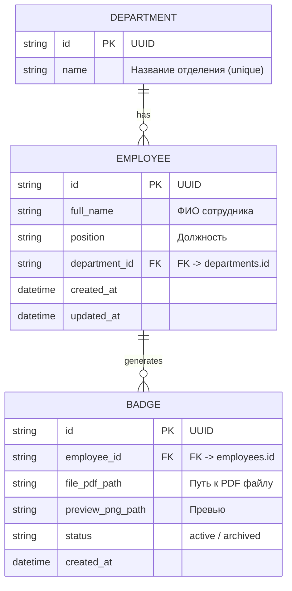

# Сервис двусторонней генерации служебных бейджей
### КГП на ПХВ «Многопрофильная больница г. Темиртау» / ШЖҚ «Теміртау қаласының көп бейінді ауруханасы» КМК

Production-ready веб-сервис для двусторонней векторной генерации служебных медицинских бейджей (300 DPI), ведения реестра сотрудников в базе данных PostgreSQL и пакетной печати на листах формата **А4** со спуском полос и метками для реза (Crop marks).

---

## 1. Возможности сервиса

1. **Двусторонний формат со сгибом (Folded Badge):**
   - **Физический размер:** 90 × 60 мм (в развороте — 180 × 60 мм с центральной пунктирной линией сгиба).
   - **Лицевая сторона (Front):**
     - Двуязычная официальная шапка больницы на казахском и русском языках.
     - Диагональные зеленые полосы `#1e5d36` и `#67b83d` в левой нижней части.
     - Векторная круглая эмблема больницы («Многопрофильная больница / МБ ТЕМИРТАУ»).
     - ФИО сотрудника (крупный полужирный гротеск, автоперенос на 2–3 строки с авто-подгонкой кегля).
     - Разделительная темно-зеленая линия `#1e5d36`.
     - Должность и отделение сотрудника.
     - Поддержка расширенной казахской кириллицы (глифы **Ә, І, Ң, Ғ, Ү, Ұ, Қ, Ө, Һ**).
   - **Оборотная сторона (Back) — «КОДЫ ПО БЕЗОПАСНОСТИ»:**
     - Таблица служебных кодов экстренного реагирования в соответствии со служебной памяткой:
       - **БЕЛЫЙ:** Агрессивный пациент или посетитель (Охранная служба, диспетчер).
       - **КРАСНЫЙ (`#e3342f`):** Пожар (Начальник АХЧ, Тушить - Эвакуировать).
       - **СИНИЙ (`#2563eb`):** Оказание неотложной мед. помощи (Код Синий, реанимация).
       - **ЖЕЛТЫЙ (`#f59e0b`):** Разлитие химических веществ (Код Желтый).
       - **ЧЕРНЫЙ (`#1f2937`):** Угроза террористического акта (Старший менеджер безопасности).

2. **Интерактивный конструктор (Live Preview):**
   - Мгновенная визуализация при наборе текста с переключением вкладок: «Лицевая сторона», «Оборотная сторона (Коды)», «Разворот со сгибом».
   - Панель быстрой вставки казахских букв (`Ә`, `І`, `Ң`, `Ғ`, `Ү`, `Ұ`, `Қ`, `Ө`, `Һ`).
   - Масштабирование холста (Zoom 80% — 150%).
   - Генерация в 1 клик с автоматическим скачиванием векторного PDF.

3. **Реестр сотрудников и бейджей:**
   - Полнотекстовый поиск по ФИО и должности.
   - Фильтрация по отделениям больницы.
   - Пагинация и массовый выбор чекбоксами.
   - Действия: «Быстрая печать», «Скачать PDF», «Удалить».

4. **Пакетная печать на листы А4 (Batch Printing):**
   - Выбор нескольких сотрудников $\to$ формирование листа А4 (до 4 сложенных пар 180×60 мм на страницу).
   - Угловые пунктирные метки для реза (Crop marks) для точной обрезки канцелярским резаком.
   - Готово для печати и последующего ламинирования.

5. **Массовый импорт из Excel и CSV:**
   - Поддержка файлов `.xlsx`, `.xls`, `.csv` (UTF-8, Windows-1251).
   - Колонки: `ФИО`, `Должность`, `Отделение`.
   - Встроенная кнопка скачивания типового шаблона таблицы.

---

## 2. Архитектура и стек технологий

```
                        ┌──────────────────────────────┐
                        │   Nginx Reverse Proxy (:80)  │
                        └──────────────┬───────────────┘
                                       │
                ┌──────────────────────┴──────────────────────┐
                ▼                                             ▼
   ┌─────────────────────────┐                   ┌─────────────────────────┐
   │  Frontend (React+Vite)  │                   │  Backend (FastAPI+Py3)  │
   │  TypeScript + Tailwind  │                   │  WeasyPrint / ReportLab │
   └─────────────────────────┘                   └────────────┬────────────┘
                                                              │
                                                 ┌────────────┴────────────┐
                                                 ▼                         ▼
                                      ┌────────────────────┐   ┌──────────────────────┐
                                      │ PostgreSQL 16 (DB) │   │ Storage (PDFs 300DPI)│
                                      └────────────────────┘   └──────────────────────┘
```

- **Backend:** Python 3.12, FastAPI, SQLAlchemy 2.0 Async, Pydantic v2, WeasyPrint + ReportLab (двойной движок для 100% стабильности в Docker и на хост-системах), Pandas, OpenPyXL.
- **Frontend:** React 19, TypeScript, Tailwind CSS, Lucide Icons, Vite.
- **Database:** PostgreSQL 16 (с авто-миграцией и SQLite фолбэком для автономного запуска).
- **Web-Server:** Nginx Reverse Proxy (кэширование статики, маршрутизация API, gzip-сжатие).

---

## 3. Схема базы данных



---

## 4. Запуск сервиса

### Вариант 1: Запуск через Docker Compose (Рекомендуемый для Production)

Убедитесь, что установлены Docker и Docker Compose. Выполните:

```bash
docker-compose up --build -d
```

Сервис будет доступен по адресу:
- Веб-интерфейс: **http://localhost**
- Swagger API документация: **http://localhost/api/docs**
- ReDoc API: **http://localhost/api/redoc**

Остановка:
```bash
docker-compose down
```

---

### Вариант 2: Локальный запуск для разработки

#### 1. Запуск Бэкенда (FastAPI):
```bash
cd backend
python -m pip install -r requirements.txt
python app/main.py
```
Бэкенд запустится на `http://localhost:8000`. При первом запуске автоматически создаются таблицы БД и выполняется сидирование тестового медперсонала.

#### 2. Запуск Фронтенда (React + Vite):
```bash
cd frontend
npm install
npm run dev
```
Фронтенд запустится на `http://localhost:5173` с автоматическим проксированием запросов к бэкенду.

---

## 5. API Спецификация

| Метод | Эндпоинт | Описание |
| :--- | :--- | :--- |
| `POST` | `/api/badges/preview` | Возвращает HTML/CSS код для живого рендеринга стороны бейджа (`front`, `back`, `folded`) |
| `POST` | `/api/badges/create` | Создает сотрудника, сохраняет бейдж в БД и генерирует векторный PDF |
| `GET` | `/api/badges` | Список сгенерированных бейджей с пагинацией и поиском |
| `GET` | `/api/badges/{id}/download` | Скачивание индивидуального PDF файла бейджа |
| `POST` | `/api/badges/print-sheet` | Принимает список `badge_ids`, генерирует спуск полос на лист **А4** с метками реза |
| `DELETE` | `/api/badges/{id}` | Удаление бейджа и связанного файла |
| `GET` | `/api/employees` | Список сотрудников больницы с фильтрацией по отделению |
| `POST` | `/api/employees/import-csv` | Массовый импорт из Excel / CSV с автоматической генерацией бейджей |
| `GET` | `/api/employees/export-template` | Скачивание эталонного CSV-шаблона для заполнения |
| `GET` | `/api/departments` | Список медицинских отделений |

---

## 6. Тестирование

Для запуска интеграционного тест-сьюта выполните:
```bash
cd backend
python -m pytest tests/test_api.py -v
```
Тест проверяет полный цикл работы: инициализацию БД, проверку здоровья, рендеринг предпросмотра, сохранение бейджа в БД, загрузку PDF, сборку листа А4 и парсинг CSV.
